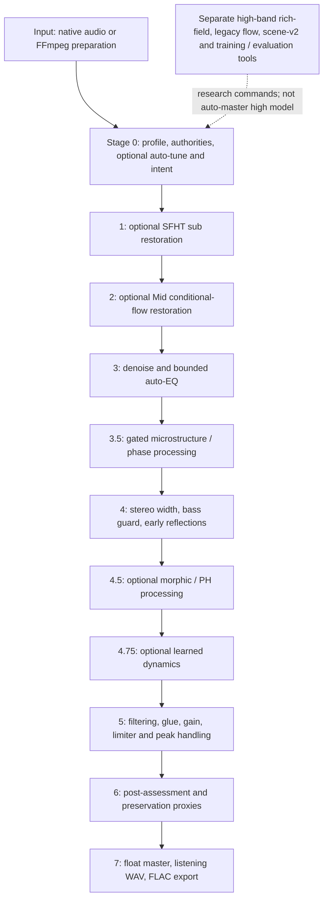

# RoachAudioMasterer: deep architecture audit and research program

**Audit date:** 2026-11-08 (local); checkout `experiment/phase3-geometric-moonshot`, HEAD `41a0889`. This report is a research decision document, not a proposal to silently change the current master. It is self-contained: repository paths identify inspectable evidence, but the principal findings and limits are reproduced here. No model training, speed experiment, production modification, or listening trial was performed for this audit. Read “measured” as a named measurement on a specified sample, “code observation” as behavior inferred from this checkout, and “hypothesis” as an unvalidated prediction. Earlier results are explicitly identified as historical.

## Executive assessment

Roach already has a substantial, coherent foundation: procedural training, several small band-specialist models, input-derived routing, explicit strength controls, classic DSP, CPU reference implementations, optional OpenCL, stage diagnostics, preserved checkpoints and unusually candid negative results. Its current champion, NextGen v1.3.1 Smooth at `493cdcad1b06b97297fb3837fc2a851c4533e326`, earned positive owner feedback, but the documented preference was unblinded and not established across listeners or tracks. The later `41a0889` checkout contains additional optional research and diagnostics; it is not interchangeable with the champion binary. The older Git tag `v1.1.0-alpha.1-champion` names another earlier freeze and is not the v1.3.1 commit.

The central scientific problem is not insufficient synthesis capacity alone. Today multiple independently motivated stages can modify the same treble, stereo, envelope, and phase features, while the principal preservation proxy covers only a narrow midrange property. Input-only heuristics and some static spectral targets are called upon to make perceptual decisions they have not been validated to make. A promising long-term direction is a **shared, auditable, budgeted hybrid engine**: an input and intent assessment; an optional hierarchical decision policy with an abstain action; bounded, interpretable DSP and residual operators; and independent signal- and listening-based verification. Keep clean bypass, frozen champion, useful model weights, procedural assets, phase/coherence work and backend isolation. Allow major replacement if controlled comparisons justify it. No existing or proposed system can infer the historically true recording from an arbitrary stereo master.

The highest-value next experiment is a **pinned, stage-isolated high-frequency diagnosis**, starting with the existing exact-baseline clean-stage factorial on Singularity, and a separate qualified trace of the Smooth champion including the 8 kHz PH entry. Test the auto-EQ interpolation mathematically and with generated signals, then evaluate a predeclared corrected candidate against the frozen implementation, an EQ-only matched-energy control and identity. Follow with loudness-matched, randomized listening on multiple independent tracks. This yields actionable causal evidence before committing to model expansion or system replacement.

## Scope, baseline and reading the evidence

The project defines expansion as a first-class goal, including spectral, transient, microdynamic and contrast expansion, phase/coherence, stereo, ambience/depth, de-fizz and partial resynthesis. The appropriate constraint is not “never change a spectrum”; it is **intervention proportionate to a defensible benefit**, with identity, artistic intent and uncertainty made explicit. Restoration tries to reduce an identified defect; enhancement intentionally changes presentation; creative reconstruction synthesizes plausible material. Plausible is not authentic. A track can benefit from a deliberately audible tonal change while still preserving identity; no magnitude metric decides that question.

This audit inspected `README.md`, `docs/ARCHITECTURE.md`, `RESULTS.md`, the frozen `docs/V1_ALPHA_FREEZE.md`, `docs/NEXT_EVOLUTION_PLAN.md` context, current results and source; delegated independent DSP, ML and primary-literature reviews were reconciled with source and receipts. No comprehensive new run of every model, no actual listening, and no full track-by-track validation was undertaken. Tests reported below are historical unless explicitly described as new. This document is not an exhaustive line-by-line proof of every module.

## 1. Actual system architecture

Text equivalent: input is decoded and profiled; enabled low and mid specialists process it, followed in order by clean, optional microstructure, spatial, optional morphic and dynamics stages, and final loudness/peak control; the result is assessed and exported. Exact applied settings depend on flags, resolved checkpoints and assessment. `src/main.rs::auto_master_pipeline` is the authoritative orchestrator, approximately lines 2289–3122. FLAC is normally passed through FFmpeg to 48 kHz stereo; other inputs are read natively if accepted and transcoded on failure. The mid path writes and rereads a WAV. Check run artifacts, actual samples, format and binary identity rather than assuming every invocation shares a preparation path.

`SceneAssessor` in `src/assess.rs` derives acoustic features and specialist authorities; `src/musical_intent.rs` modifies an auto-tuning card. They are heuristics, not validated reading of artistic intention. `src/sfht.rs` implements the low specialist; `src/rich_mid.rs` implements bounded Mid flow; `src/scene_clean.rs` supplies high-frequency denoising and auto-EQ; `src/microstructure.rs` provides gated phase/texture processing; `src/spatial.rs::process_spatial_with_contrast` handles mono bass, width and early reflections; `src/gtf.rs` contains geometric and port-Hamiltonian variants. `src/dynamics.rs` is a separate default-off experimental dynamics model. `src/master.rs::master_audio_with_observer` applies final filtering, optional sub guard, transient shaping, glue, gain and limiting with loudness and true-peak estimators. `src/master_audit.rs` can observe bounded finalizer snapshots. Assessment is not an automatic perceptual acceptance test. The 24-bit FLAC is encoded from the float master, while the separate listening WAV is PCM16; export depends on FFmpeg.

**Important invocation distinction.** The README champion recipe explicitly selects `artifacts/rich-low-sfht-v2/basis.json`, `artifacts/rich-mid-v3/basis.json`, `--auto-tune`, `--morphic-mode ph-lie-v2`, `--phase-consistency 0.5`, `--target-lufs -13`, `--kick-transient-guard`, and `--quiet-mid-denoise`. The automatic model resolver in `src/main.rs` instead prefers older low and Mid checkpoints when explicit paths are absent. Bare defaults also differ in morphic mode and loudness. A label or filename does not authenticate a binary, model, tuning card, or settings. Preserve the binary hash, Git dirty state, input hash, model hashes, command, base and effective tuning cards, stage settings and output hash.

**Underused / misunderstood capability.** The separate learned `rich-field` high-band research model is not called by `auto-master`, nor by the legacy `rich-triband-restore` low/mid coordinator. It is available via separate `rich-field-*` commands. This does not mean treble is unchanged: clean, microstructure, spatial, PH, and finalization can all affect it. Existing strength-zero and protected-band contracts belong to individual research paths and do not automatically make the entire mastering chain identity at zero.

## 2. High-frequency investigation

### Fresh descriptive measurement

A local test compared `/sdcard/Download/Singularity Moment ext v1.1.2.1.1 remix v2.flac` (SHA-256 `87993dc798fe0faf36259a78d0adbd41cf978a61be41ed79c7dc02ceb32336da`) to the local file labeled `[Roach NextGen v1.3.1 Smooth -13 LUFS].flac` (SHA-256 `11b458a53c03429192a0250dd40ffb05eef0152352a416538db65a80a1904e41`). The source hash matches the separately frozen `artifacts/singularity-clean-factorial-20261021/plan.json`. It is a plausible same-song pair, but this audit did not authenticate the historical master render's complete provenance or prove that it is the precise pair behind the user's preliminary measurement. Both decode to 48 kHz stereo, 6,293,504 frames, 131.115 s. Shared geometry is not proof of perfect alignment.

Each FLAC was decoded to float32 with FFmpeg; `scripts/analyze_master_pair.py` (SHA-256 `cee8a820c05f2d340c62736188fb0c11cc0558fded7a14397db8edce6b9c7a08`) streamed 3,072 complete symmetric-Hann 4096-point windows, hop 2048, averaged L/R channel powers, and subtracted the whole-track pooled RMS change of **−0.2294 dB** from each band power ratio. This is a broadband RMS normalization, not integrated-loudness matching. Fresh data and definitions are in ignored local `runs/deep-architecture-audit-20261108/analysis/`; no private audio is included in this report.

| Band (Hz) | Master/source normalized energy change |
|---|---:|
| 20–120 | −0.291 dB |
| 120–500 | −0.106 dB |
| 500–2,000 | +0.680 dB |
| 2,000–8,000 | +0.944 dB |
| 6,000–8,000 | +1.097 dB |
| 8,000–10,000 | +2.504 dB |
| 10,000–12,000 | +2.295 dB |
| 8,000–12,000 | +2.448 dB |
| 12,000–14,000 | +1.456 dB |
| 14,000–16,000 | +1.602 dB |
| 16,000–20,000 | +1.366 dB |
| 8,000–20,000 | +2.368 dB |

Band powers were integrated before conversion to dB; these are not averages of dB bins. The local result supports concentrated relative high-band change, but not the numerical +1.5–1.7 dB assertion for an unspecified comparison. The differences between adjacent broad bands suggest a transition, but their averages alone cannot prove an abrupt filter boundary or locate a cause. No validity claim is made for individual low-power bins. Full-track L/R correlation changed 0.9010→0.8844; pooled waveform correlation was 0.9611; global sample crest changed 14.787→13.607 dB and source-fixed 100 ms crest median changed +0.106 dB. One-second RMS p90–p10 changed 12.141→9.508 dB. These describe this pair, not attack preservation, interchannel coherence, sound quality, or causal compression. Fixed-window crest is not transient fidelity, and whole-track correlation is not frequency-dependent coherence. No phase/group-delay, modulation-spectrum, spectral-flux or instrument-specific artifact measurements were independently completed for this pair. Vocal sibilance, cymbal decay, reverb and fizz require source-anchored excerpts and listening; none is claimed improved or damaged here.

**Reproduction:** decode the two named FLACs as float WAV to a fresh private directory, then run `OPENBLAS_NUM_THREADS=1 python scripts/analyze_master_pair.py --source SOURCE.wav --master MASTER.wav --out NEW_DIRECTORY`. On this Termux device FFmpeg/ffprobe require `LD_PRELOAD=/data/data/com.termux/files/usr/lib/libc++_shared.so`. Sum `source_psd` and `master_psd` rows in `spectrum.csv` for 8,000 ≤ f < 12,000, take `10 log10(master/source)`, and subtract the reported broadband RMS gain. Preserve original hashes; do not overwrite prior runs. Sample-grid alignment is assumed, not established by the analyzer.

### Possible mechanisms and concrete correctness risks

1. **Auto-EQ** (`src/scene_clean.rs::bounded_auto_eq_with_quiet_gate`) estimates eight broad-band energies and nudges them toward an approximately −3.8 dB/octave reference. This is a fixed aesthetic prior with input-adaptive deltas, not an estimate of recording quality. Its 8–14 kHz band can move up or down. The code's purported raised-cosine weight is `w=[0.5+0.5 cos(pi(1−d/1.5))]^2` for octave distance `d<1.5`: it is zero at a band's center and approaches one just inside support, then is zero outside. With unequal band corrections, the weighted average can jump at support boundaries. This is a mathematical code observation, **not** proof that it produced the measured 8 kHz feature. A corrected taper changes sound and must be a separate candidate, with zero/constant and one-band response tests, then listening. `max_adjust_db` is clamped to at least 0.5 dB internally; `--auto-eq-max-db 0` is not a valid EQ bypass. Use the explicit no-auto-EQ control.
2. **PH spectral control** (`src/gtf.rs` around 4499) begins modifying bins at a configured crossover, commonly 8 kHz in this mode, and has an approximately 12 kHz cosine split plus an upper-air taper. The initial crossover-bin entry does not itself have a smooth transition. The `ph-lie-v2` configuration includes a nominal shelf and dynamic M/S changes. STFT windowing, downstream processing and passband locks mean a hard loop boundary is not by itself a measured audible step. A single-stage render and sine/swept-noise controls are required.
3. **Denoising and microstructure.** High-band minimum-statistics Wiener processing in `scene_clean.rs` acts separately on channels and can suppress or alter diffuse tails and sibilants. Finite-SNR gains approach but are not exactly unity on attacks. Quiet-Mid denoising and Stage 3.5 `microstructure::process_microstructure` can affect texture and phase; an artifact detector may mistake wanted noisy cymbals or vocal breath for fizz. Such processing can also expose or emphasize existing artifacts rather than add beneficial detail. Track-global parameters do not imply uniform time-local gain.
4. **Spatial and finalization.** The spatial LR4 split is causal and its summed branches can have all-pass phase rotation even at nominally neutral side gain; the champion's zero-phase LR4 claim concerns a different master-guard path. Delayed reflections change phase and frequency response. Compression, limiter and time-varying gain can change band-relative energy and modulation. Whole-track correlation-based stereo guards do not ensure time/frequency-local coherence or preserve intentional antiphase. The final peak correction depends on selected controls; the champion guard and bare-default paths must not be conflated. Finite oversampling is an estimate, not a continuous-time peak guarantee.
5. **Reporting integrity.** `gtf.rs` assigns `channel_swap_equivariance_passed: true` in the audit record; it is not a per-track measured proof. `assess.rs::verify_preservation` is a first-channel broadband-normalized tapered 1–2.5 kHz RMS proxy (with skirts), not a guarantee on all bins, vocals, timing, stereo or perceived quality. Its 256-sample envelope cosine is not a full transient timing audit. Later processing can modify content protected within an earlier model stage.

Historical evidence narrows but does not settle causality. On the distinct AROUND v2 run, the post-hoc Stage 3 clean boundary first crossed the native-style 1 dB preservation proxy; denoise and EQ were combined (`docs/AROUND_MASTERING_RESULTS_20261022.md`). A separate exact-baseline Singularity clean factorial measured signed proxy increments of approximately +0.099 dB denoise, +0.607 dB EQ, +0.714 dB combined, and +0.008 dB interaction relative to its declared guarded comparison. This is one first-channel midrange proxy on a separate cached pipeline, not an attribution of the present champion's 8–12 kHz lift. Existing artifacts and differing configurations must not be conflated.

## 3. Existing learning systems and training evidence

The v0 research path uses a 24 kHz, 512-point STFT and a `40→32→257` residual MLP over a deterministic envelope prior (`src/model.rs`, `src/reconstruction.rs`, `src/synth.rs`). Known Fourier bins are projected back after synthesis, and zero strength is an exact bypass for that path. Procedural mixtures include partials, FM/PM, noise, events, modulation and nonlinearities, but its primary manufactured degradation is low-pass bandwidth loss, not arbitrary codecs or AI artifacts. The first complex flow (`src/flow.rs`) has 36,802 parameters, eight Euler steps and input-conditioned complex residuals. The frozen pilot did **not** establish useful conditional improvement over shaped-noise controls; 10,000 steps did not consistently improve the frozen test (`docs/FLOW_RESULTS.md`, `docs/LONGER_TRAINING_RESULTS.md`). Informal preference of one output does not reverse that experimental outcome.

Native scene-v2 uses 48 kHz complex STFT (1024/hop 256), shared M/S processing, a 3098→32→32 encoder and a 184→32→6 per-bin shared head, totaling 106,342 parameters, plus multiscale 256/1024/4096 waveform losses and harmonic/noise-informed initialization (`src/scene_model.rs`, `scene_features.rs`, `scene_engine.rs`, `scene_loss.rs`). Historical deterministic and flow phases used bounded two-second procedural scenes and sampled short patches; sampled-block optimization does not demonstrate full-track coordination. Results improve some metrics against some priors while failing other controls; held-out generator-family generalization was not established. A reported song adapter is self-supervised and optional: user authorization is required before any new self-supervised adaptation. Do not equate its existence with authorization or general transfer.

The actual Mid-v3 checkpoint has 106,342 parameters and its audited training record contains 2,000 records and 500 scene seeds. Historical generic metadata incorrectly describes a 9,793-parameter v0 24 kHz model; the audited checkpoint shapes and dirty historical source mean exact lineage is not fully authenticated (`artifacts/mission-20261018/training_metadata_audit.json`). `docs/NATIVE_MID_SOLVER_DEV_RESULTS_20261018.md` reports every neural arm worse than identity on complex NMSE in all ten specified procedural cases despite improvements in a magnitude-only score. This is a serious identity/fidelity counterexample, not proof that no perceptual benefit is possible.

The experimental dynamics head is a 961-parameter `28→32→1` model providing bounded linked gain knots and clip RMS normalization. In the reported v2 1,800-step average, manufactured compression NMSE was 0.022873 versus identity 0.028395 and fixed DSP 0.023079; the predeclared ≥5% DSP gain, healthy false-change, and out-of-distribution operator gates failed (`docs/DYNAMICS_V2_RESULTS.md`). It stays default-off. Current `src/dynamics.rs::Model::predict` applies a rational gate and hard deadzone; `loss_gradient` uses ungated gains, so the current inference and training objectives differ. The training receipt's description says healthy weight 6 and deadzone, whereas current loss code uses 4 and no gate; the historical source was dirty, so this is a present source/metadata inconsistency, not proof of what generated the old checkpoint. A successful true-peak bound also requires validation after the whole mastering chain, not just local gain bounds.

**Shortcut risk:** current `src/rich_synth.rs::generate` and `generate_mid` use the sampled damage cutoff in constructing parts of the nominal healthy target. Damage and source characteristics are therefore not independent in those families. This may allow a shortcut; its actual effect on historical models is unknown. Generate each clean source once, draw independently crossed degradations, split by source recipe and family, and test if performance persists. Do not infer that a larger nominal scene count equals broader independent musical coverage. Preserve old checkpoints and exact generators for honest comparisons.

## 4. Component disposition and strategic options

| Disposition | Components and reason |
|---|---|
| Retain essentially unchanged | Frozen champion binaries/checkpoints, exact recipes and negative results; explicit zero/bypass contracts; procedural-only default training; CPU reference, optional parity-gated bounded GPU; immutable listening/source provenance; loudness/peak safeguards and direct float export, subject to versioned conformance tests. |
| Improve / integrate | Stage tracing, preservation checks, calibration of authorities, transient and stereo analysis, source-fixed A/B listening, loss/identity controls, model metadata and generator independence. Expose actual applied parameters rather than implying intent recognition. |
| Preserve function, redesign implementation if tested | Auto-EQ smooth interpolation, competing high-band processing, denoise/stereo linking, input-preparation consistency, per-stage budgets, PH shelf and smoothing, limiter auditing. Keep useful tone, depth, dynamics, harmonic and texture capabilities even if their implementation is consolidated. |
| Potentially redundant or counterproductive | Uncoordinated overlapping treble boosts/denoise/reconstruction, target-curve nudges on already intentional sound, artifacts scored as simple proxy numbers, hard-coded success metadata. Redundancy is a hypothesis until stage ablation and matched output are tested. |
| New only if justified | Calibrated benefit/uncertainty estimation, structured control bus and independent verifier; optional source-consistent reconstruction; section-aware human intent. No generative replacement is justified merely by existence of a new model. |

| Strategy | Benefit | Effort / compute | Main migration and fidelity risk |
|---|---|---|---|
| Incremental: repair and expose current chain | Fastest feedback; preserves proven workflow and checkpoints | Low–moderate, phone feasible | Layered interactions remain; fixes change sound and need new versioned baseline. |
| Selective rearchitecture: unified controller/budget and retained operators | Coordinated restraint, explainability, shared safety envelope; supports future models | Moderate–high; staged CPU-first implementation | Policy or shared budget can suppress valued effects; need explicit identity and backwards-compatible champion mode. |
| Radical differentiable or generative engine | Jointly optimized timing, tone, space and texture; potentially fewer contradictory stages | High research, data and compute; phone may only run compact distilled models | Regressions, ambiguous causality, musical hallucination, training-distribution bias, fidelity and reproducibility risk; likely natural-audio-trained components outside current authorization. |

**Recommendation:** pursue selective rearchitecture as a hypothesis and interface design, with incremental diagnostics first; retain radical alternatives in head-to-head research. Do not deploy the interface merely for speculative compatibility. A radical system is justified only if it wins on predeclared blind preference and preservation endpoints, at comparable compute and with explicit failure behavior. In particular, constrained modification can improve fidelity to perceived musical intent even when a spectral distance increases; conversely, a small error may be audible at a vocal consonant.

## 5. Proposed hybrid architecture and controls

1. **Input and immutable reference:** preserve decoded source, rate, channel geometry, checksum and loudness; keep artwork/metadata and never train on user song audio without specific authorization. Detect unsupported formats and fail clearly. Define identity as exact waveform pass-through at the agreed pipeline boundary; conversion/encoding must be reported separately.
2. **Analysis:** offline multiresolution STFT and transient/envelope views, M/S and L/R cross-spectra, critical-band features, local spectral flux, harmonic/noise likelihood and clipping/codec indicators. Multi-scale is valuable because fast attacks and slow reverberation cannot share a single optimal window. These are observations, not instrument or defect labels with guaranteed truth.
3. **Intent and policy:** a small global/section controller proposes a restoration/enhancement budget; local controllers adjust bounded parameters smoothly with hysteresis and attack/release, limited slew and a no-action option. An offline noncausal controller can use whole-track context; a future causal version needs declared latency and cannot assume future samples. Distinguish confidence that a defect exists, estimated benefit, and uncertainty about the correct output. A confidence score is not calibrated uncertainty until validated on independent examples and distribution shifts.
4. **Action:** coordinate linked conventional EQ/dynamics, selective texture treatment, coherent stereo operators and optional small residual models. Enforce separate bounds by content and action rather than a single scalar: protected timing, common/side phase, gain, peaks, temporal modulation, local changes, and special treatment around silence and attacks. Stronger creative settings may relax predeclared boundaries but must never generate unconstrained new notes or misrepresent synthesized content as recovered.
5. **Verification and fallback:** compare before/after at multiple scales, record active controls and finite checks, detect excessive unexpected change, and attenuate or revert a candidate according to declared policy. Verify final loudness and peak *after* all processing and export. The verifier must be independent of the controller's own score; failing closed can mean a less processed output or an explicit report rather than silent normalization.

A compact user interface can express **transparent**, **adaptive**, **restorative**, and **creative** profiles with a common engine, plus restoration amount, preservation/creative allowance, and perhaps a single texture character control only after listening establishes its usefulness. At restoration amount zero, the restoration subsystem must be exact bypass; transparent *whole-system* identity requires explicit mastering, spatial and export semantics, not just this one knob. These profiles are design proposals, not current validated modes. A future preference learner may adjust a bounded prior from multiple pairwise comparisons across tracks, with identity/no preference available, held-out tracks, consent and a reset. It must not infer a universal taste from one recording or tune to frozen tests.

## 6. Physics and perception: use constraints, not imaginary ground truth

Harmonic and inharmonic partial tracking, smoothly evolving phase, resonance damping and attack/decay models can regularize plausible residuals, especially for isolated synthetic cases. In a polyphonic mastered stereo mixture there may be multiple overlapping sources, modulation and intentional effects: a single oscillator or room model is non-identifiable. Avoid forcing cymbal noise into harmonics or describing a plausible reverb as the original room. Analysis-by-synthesis can compare alternative explanations, but model mismatch can produce a confident wrong answer. Stereo constraints should use local complex cross-spectra, interchannel phase/time/level differences, mono sum and side energy, with energy floors and confidence intervals; phase near silence is undefined. Group delay requires unwrapped reliable phase and should be measured relative to a well-defined reference, not over-interpreted in mixtures.

Psychoacoustic weighting may prioritize audible changes: frequency and temporal masking, critical-band energy, loudness, modulation and transient-sensitive penalties. Use soft, capped weights with an unweighted safety term: masking models can miss exposed consonants, codec warble or future playback conditions. A practical training objective could combine multiresolution log-magnitude and linear magnitude, a complex or waveform loss when a trusted aligned target exists, onset and decay envelope losses on source-fixed events, local modulation loss and bounded stereo cross-spectrum loss; additionally enforce identity on healthy inputs and penalty for unnecessary residual energy. Tune weights on validation sources, report each component and compare to unweighted and DSP/identity controls. No single learned perceptual metric is established for creative mastering; scores can reward brightness, similarity or loudness without preference.

A useful speculative combination is **source-conditioned residual decomposition**: separate a confidence-limited tonal continuation from a decorrelated but stereo-consistent diffuse residual, with transient guard, then allow tiny bounded local diffusion only in a selected texture region. Hypothesis: compared at matched total band energy, this reduces objectionable concentrated hiss/metallic modulation without smearing attacks. Falsify with held-out sibilants, cymbal decays, intentional tape hiss and noisy percussion; reject if matched blind preference or preservation fails. Such a decomposition is an approximation, not separation of the actual sources.

## 7. Research context: primary sources and applicability

These are research references, not performance claims for Roach. “Proposed” means not implemented here; “adapted” identifies project work described in `docs/REFERENCES.md`.

- **Adapted flow:** Yaron Lipman et al., *Flow Matching for Generative Modeling*, [arXiv:2210.02747](https://arxiv.org/abs/2210.02747). The project uses a small conditional vector-field regression, not an automatic guarantee of useful or faithful conditional audio.
- **Adapted hybrid modeling:** Jesse Engel, Lamtharn Hantrakul, Chenjie Gu and Adam Roberts, *DDSP: Differentiable Digital Signal Processing*, [arXiv:2001.04643](https://arxiv.org/abs/2001.04643). Harmonic/noise synthesis and differentiable controls inspire structured operators; monophonic examples do not resolve mastered polyphonic mixtures.
- **Proposed compact comparison:** Pierre-Antoine Grumiaux and Mathieu Lagrange, *Efficient bandwidth extension of musical signals using a differentiable harmonic plus noise model*, [DOI:10.1186/s13636-023-00315-5](https://doi.org/10.1186/s13636-023-00315-5). Compare a similarly structured small operator to the current prior and identity; published listening does not transfer to Roach's AI mixes.
- **Proposed controllable flow:** Carlos Hernandez-Olivan et al., *Single-step Controllable Music Bandwidth Extension With Flow Matching*, [arXiv:2601.14356](https://arxiv.org/abs/2601.14356). Spectral-contour control suggests an ablation, but a target contour could impose a brighter aesthetic. Natural-audio-trained research is not equivalent to Roach's authorized procedural training.
- **Background generative inverse problems:** Eloi Moliner, Filip Elvander and Vesa Välimäki, *Blind Audio Bandwidth Extension*, [arXiv:2306.01433](https://arxiv.org/abs/2306.01433); Moliner et al., *A Diffusion-Based Generative Equalizer for Music Restoration*, [arXiv:2403.18636](https://arxiv.org/abs/2403.18636). Joint operator inference and priors are relevant to ambiguous damage. Zero-shot inference does not mean corpus-free: learned priors use natural audio. Iterative costs and hallucination risk favor a long-term creative research arm, not an immediate phone default.
- **Proposed DSP control:** Christian J. Steinmetz, Nicholas J. Bryan and Joshua D. Reiss, *Style Transfer of Audio Effects with Differentiable Signal Processing*, [arXiv:2207.08759](https://arxiv.org/abs/2207.08759); Steinmetz et al., *ST-ITO*, [arXiv:2410.21233](https://arxiv.org/abs/2410.21233). Parameter prediction and black-box optimization motivate auditable controller alternatives. Reference style is not automatically improvement; optimization can game a metric and may be expensive.
- **Proposed perceptual losses:** Zhen et al., *Psychoacoustic Calibration of Loss Functions for Efficient End-to-End Neural Audio Coding*, [arXiv:2101.00054](https://arxiv.org/abs/2101.00054), and Abreu et al., *Efficient Audio Enhancement with a Differentiable Psychoacoustic Loss*, [arXiv:2608.02918](https://arxiv.org/abs/2608.02918). Codec/enhancement results motivate soft masking ablations, not a universal hearing model. Compare changed loss and architecture separately.
- **Proposed texture metric:** Vahidi et al., *Mesostructures: Beyond Spectrogram Loss in Differentiable Time-Frequency Analysis*, [arXiv:2301.10183](https://arxiv.org/abs/2301.10183). Joint spectrotemporal structure motivates modulation tests; current simple diagnostics are not its scattering transform.
- **Metric caution:** Manocha, Jin and Finkelstein, *Audio Similarity is Unreliable as a Proxy for Audio Quality*, [arXiv:2206.13411](https://arxiv.org/abs/2206.13411); Torcoli et al., *ODAQ: Open Dataset of Audio Quality*, [arXiv:2401.00197](https://arxiv.org/abs/2401.00197). Evidence in their tested domains calls for metric calibration, not a blanket conclusion that all similarity measures are useless.
- **Listening and metering:** ITU-R [BS.1770](https://www.itu.int/rec/R-REC-BS.1770/en), [BS.1116](https://www.itu.int/rec/R-REC-BS.1116/) and [BS.1534](https://www.itu.int/rec/R-REC-BS.1534/en). Use loudness and true-peak metering and adapt controlled listening methods to preference and source identity; a modified experiment must not be represented as fully standard-compliant.

## 8. Prioritized hypotheses and falsification

Confidence below concerns the **reason to test**, not a promise of positive listening results. Costs are relative estimates, not measured speed.

| Priority / confidence | Mechanism and measurable prediction | Falsification / failure mode | Cost and risk |
|---|---|---|---|
| P0 / high, code correctness | Correct the auto-EQ weight in an isolated candidate; response should vary continuously across support, preserve a constant gain and exact disable. | Sweep and edge tests expose jumps or normalization errors; blinded matched-level comparisons show preferred original or vocal/cymbal harm. A mathematical fix is not automatic quality gain. | Low engineering; moderate regression risk because existing sound changes. |
| P0 / high, attribution | Full-chain pinned stage outputs and 2×2 clean controls identify which stages contribute to HF, and whether combined effect is additive. | Exact baseline replay fails, unavailable source/binary, or nonlinear interaction makes subtraction insufficient. Cross-check in several songs; do not infer component causality from a single boundary. | Low–moderate; storage for bounded snapshots; no retraining. |
| P1 / medium | Budgeted transparent/abstain policy reduces healthy-track false changes at matched measured repair benefit. | Identity is preferred or damage improves only by underprocessing; calibration fails on unfamiliar genres; A/B at fixed bounds. | Moderate implementation; small inference cost, bias from proxy labels. |
| P1 / medium | Crossed source/degradation training reduces shortcut dependence; same model beats identity, prior and uncrossed model on independent source/family/operator cases. | Improvement disappears on frozen held-out banks or hurts legitimate noise and intentional reverb. | Moderate procedural generation/training; no natural-audio training authorized. |
| P1 / medium | Section-level slow budget plus smooth local control improves preference at equal preservation and loudness vs static parameters. | Pumping, section-edge artifacts, wider harmful changes, or no blinded advantage; compare controller-disabled, equal-action-energy and identity. | Moderate–high; offline whole-track state and stability tests. |
| P2 / exploratory | Harmonic/diffuse residual with confidence gates improves texture at matched EQ and band energy. | Removes breath/cymbal tails, invents notes, stereo instability, or matched-EQ wins. | Moderate–high; requires strong null and creative-mode controls. |
| P2 / exploratory | Larger models or longer training improve out-of-family performance at a fixed data/loss budget. | No gain, identity errors rise, or gains vanish with same parameter count and multiple seeds. | Moderate locally to high remotely; independent explicit training decision. |
| P3 / low, ambitious | Joint differentiable or diffusion architecture exceeds hybrid controller in blind preference while meeting same fidelity and hardware constraints. | Hallucination, domain bias, unstable peaks, compute cost, or inferior identity controls. | Very high; learned natural-audio priors require separate authorization. |

## 9. Reproducible evaluation program

**Corpus and separation.** Establish a manifest of independent source tracks grouped by provenance, artist/session/derivative family and original/codec versions. Include pristine commercial-quality references where locally licensed, imperfect conventional mixes, AI-generated songs, vocal-spliced material, sparse and deliberately noisy/distorted/lo-fi music, mono and wide mixes, and controllably degraded synthetic signals. Keep private songs and any licensed material local. Split by source family *before* creating clips, derivatives, codecs, remixes or degradations. Develop thresholds on a validation partition only; lock test manifests, hashes, criteria, and analysis before unblinding. Consent and rights govern sharing; no natural-song training or self-supervised adaptation is authorized by this audit.

**Track-level suite.** Compare identity, frozen champion, new candidate, common-gain-only, simple fixed-EQ/denoise/dynamics controls and individual/factorial stages. Ensure common initial decode, sample rate, channels, frame count and timing; use only source-derived event windows and report alignment confidence, not output-picked shifts that hide errors. Measure integrated LUFS and true peak using independent implementation as well as native estimator; report loudness range and local envelopes, energy by third-octave or overlapping perceptual bands with uncertainty floors, spectrogram and waveform residuals, flux and onset position/attack-to-sustain on fixed events, modulation spectra, bandwise L/R complex coherence and mono sum, M/S energy, and phase/group-delay only where input energy and alignment support them. For known synthetic targets report multi-resolution magnitude, complex and waveform errors plus known-content leakage and identity/null. Report per-track distributions and worst cases; windows of the same song are not independent trials. Metrics describe transformations, not aesthetic success.

**Listening.** Preselect short difficult excerpts from source only, including vocals/sibilance, percussion decay, reverb and silence, plus full-context samples. Randomize and blind labels; include identity-vs-identity, a clearly different positive control, no preference/indistinguishable, and playback calibration. Match integrated loudness for long selections and carefully verify local level without applying per-excerpt gain that hides dynamics; separately audition true delivery level and report both. Ask separately about preference, fidelity/identity, sibilance/fizz, texture, attack, space and fatigue. Track listener, playback system, gain and uncertainty; individual listener preference is not population proof. Aggregate by source track, not snippets; predeclare sample size and statistical analysis. Prior owner listening chose the control in both actual comparisons but directional choices on identical controls and low-level playback limit interpretation (`docs/OWNER_LISTENING_RESULTS_20261021.md`). Preserve that negative/ambiguous result.

**HF experiment, concrete protocol.** (1) Freeze input, champion executable, model weights and command, tuning cards, exact timestamps and output hashes. Verify full-chain reproduction; if old binary/settings cannot be authenticated, label the exported pair observational and build a new baseline. (2) A fixed source excerpt set and signal controls: sine sweeps and steady multitone, stereo decorrelated noise, impulsive attacks, synthetic sibilants/cymbal-like decays, silence and intentional hiss. (3) Compare baseline, PH off/on, clean denoise off/on, EQ off/on, and relevant microstructure/spatial/finalizer arms with all other settings fixed. Exact 2×2 factorial means four full configurations or an authenticated replay from the same stage input; downstream nonlinearities require full-chain confirmation. (4) Plot adjacent-bin robust spectral ratios and coherence with floors; evaluate gain discontinuity around support boundaries and 8/12 kHz while accounting for window smearing. (5) Measure envelopes, decay/modulation and attack changes, then matched-energy EQ and blind listening controls. (6) Verify improvement on held-out tracks and preserve all failures. The prior AROUND exact-clean replay recommendation remains a separate next step for that source, not a reason to claim it explains Singularity.

## 10. Data, training and compute plan

Procedural generation should span independent harmonic/inharmonic, percussion/noise, voice-like formants, stereo delays and correlated/independent ambience, mix density, dynamics, clipping, codec-like filtering/quantization, controlled reverberation and spectral discontinuities. These approximate certain mechanisms; a procedural oscillator is not an AI-generated vocal corpus and a real codec test does not train on natural audio merely because it is used for evaluation. Preserve intentional noise, coloration and reverb with identity and style-conditioned controls. Cross each clean source with multiple independent damage draws, include null damage and compositional degradations in plausible order, reserve entire generator families and degradation operators. The source generator itself must not read the chosen damage cutoff if used to test independence. Document what it cannot simulate, including realistic semantic vocal artifacts.

Ablate one factor at a time: identical seeds/data with small/current/moderately wider models; matched total updates and separate longer-duration arms; equal loss scales with and without psychoacoustic weighting; independent data diversity vs increased sample count; frame context vs temporal state; deterministic prior vs learned residual vs shaped noise/identity; controller policy vs fixed matched-action controls. Use multiple initialization seeds and evaluate every predefined endpoint, never target-select a favorable stochastic sample. Distinguish training convergence from held-out perceptual benefit. Natural-audio training, external pretrained weights and song-specific adaptation require a separate, explicit authorization.

**Resource tiers:** local diagnostic = CPU sequential streaming analyses and short bounded excerpts; current-sized local research = small models, procedural short clips, chunked STFT, CPU reference and optional OpenCL parity; ambitious = larger context, diffusion or learned perceptual models, likely offline external compute and potential distilled phone inference. No cost or speedup is promised without a controlled foreground experiment, for which owner confirmation is required. The most recent AROUND runs observed approximately 1.70/1.96 GiB native high-water marks with explicit reserves; they are not timing benchmarks or universal memory bounds. Current device storage check showed about 35 GiB free at audit start. Monitor headroom, run sequentially, use Cargo `-j 8`, retain frozen binaries, checkpoints, local evidence and stopped-run receipts. Chunking must test seam/overlap consistency and not introduce arbitrary spectral or stereo resets.

## 11. Staged roadmap and acceptance gates

**Phase 0 — provenance and diagnosis.** Pin executable/model/input/outputs; complete HF and stage-ledger tests. Acceptance: exact baseline reproduction or explicit stop, verified meter/null controls, interpretable stage contribution with uncertainty, no production audio change. In parallel add tests demonstrating the auto-EQ support-boundary issue without changing champion behavior; verify train/inference dynamics discrepancy and metadata on current source.

**Phase 1 — measurement and low-risk repair candidates.** Build independent bandwise/temporal/stereo metrics with synthetic reference tests and declared failure handling; create isolated corrected-EQ candidate. Acceptance: identity, constant-gain, mono/channel-swap, silence, finite and sweep tests; preserve existing default and comparison binary; preregister listening and show no material regression on independent sources. A proxy pass alone is insufficient.

**Phase 2 — coherent action budget.** Introduce an opt-in explicit action ledger and restoration bypass, then a simple interpretable rule-based allocation against fixed-action controls. Acceptance: exact disabled-path parity, bounds and slew under adversarial sequences, no peak bypass, transparent no-action on null controls, and held-out listening benefit. Use this phase to decide whether a common structured control interface is warranted.

**Phase 3 — learning and data.** Repair objective/inference mismatch in a new experimental dynamics version; cross source/degradation factors and compare small models against identity and fixed DSP with multi-seed training. Acceptance: preregistered healthy, held-out family/operator, true-peak, source-fidelity and listening criteria all pass. No forced promotion based on a single favorable metric.

**Phase 4 — hierarchical model control and reconstruction.** Only after preceding controls work, evaluate a bounded offline section controller, calibrated abstention and optionally structured residual. Acceptance: reproducible gains over simple controller and EQ-matched controls, preserved vocal identity and timing, no invented musical events in defined probes, stable stereo and bounded memory; separate creative intervention from faithful profile. Confidence must be evaluated out of distribution.

**Phase 5 — radical alternatives.** Prototype differentiable or generative systems behind the same evaluation contract. Acceptance: independent training authorization where needed, auditable data/model provenance, competitive compute and demonstrable held-out listening benefit without increased catastrophic failures. Migration requires an explicit implementation decision; preserve a runnable frozen champion.

## 12. Open questions and decision

- Is the local Smooth export exactly the user's compared master? Obtain its original render receipt and verify binary, input, checkpoints, flags and hash before making causal claims.
- How much of the HF difference is EQ interpolation, PH crossover/shelf, microstructure, stereo or finalizer interaction? Does a loudness- and energy-matched EQ control reproduce the preference? The present measurement cannot answer.
- Can an input-only policy tell a desired hiss or aggressive cymbal from an artifact reliably enough to abstain? What is its calibration on unknown codecs and AI vocals?
- Can a loss protect vocal identity, attacks and stereo without suppressing intentional expansion? Which evaluation metrics agree with blinded listener decisions?
- How much benefit remains after an independently crossed source/degradation generator, source-held-out splits, and matched model budgets? Are old checkpoint metadata sufficient for an exact replay?
- Can full-track multi-scale context fit phone memory without introducing chunk seams? Any speed answer requires a fresh, explicitly authorized foreground benchmark.

**Decision:** Keep the existing champion available; do not train or redesign yet. First reproduce the pinned chain and test HF stage mechanisms, including the concrete auto-EQ interpolation defect, with a matched-EQ and identity baseline. That experiment is inexpensive relative to a new model, distinguishes code correctness from subjective taste, and directly informs whether the next investment should be a local fix, coordinated controller, or more radical architecture.
